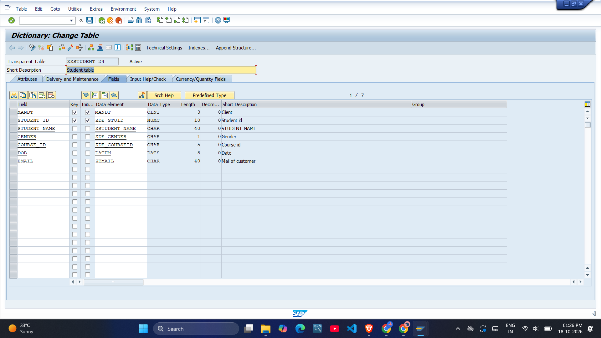
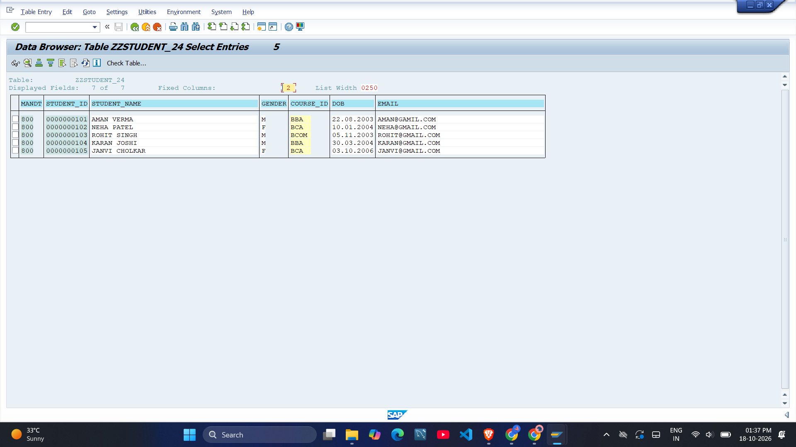
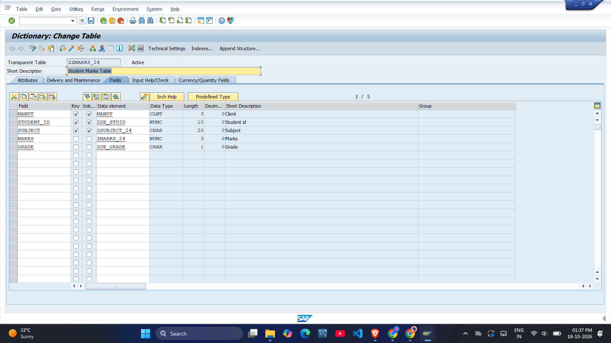
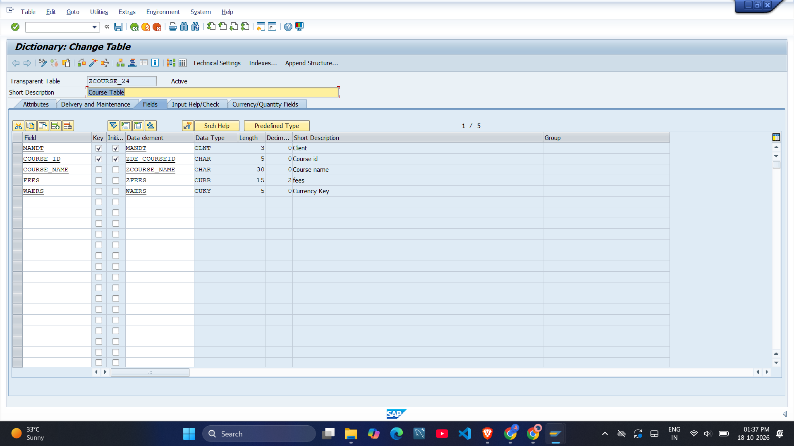

# Student Management System (SAP ABAP Data Dictionary)

A mini project built on an SAP ECC system using only Data Dictionary (SE11) objects.

## Package
`ZJC_PRAC_PACKAGE`

## Objects

| Type | Name |
|------|------|
| Tables | ZZSTUDENT_24, ZCOURSE_24, ZZMARKS_24, ZCOURSE25 |
| Domains | ZCOURSE_NAME, ZMARKS_24, ZSUBJECT_24 |
| Data Elements | ZCOURSE_NAME, ZMARKS_24, ZSUBJECT_24 |
| Search Help | ZSTU_COURSE_SH24 |
| View | ZSTU_MARKS_VIEW |
| Lock Object | EZSTUDENT_24 |

## How this repo was created
The package was exported from SAP using abapGit (ZIP export) and uploaded here.
Each object is stored as an XML file inside the `src` folder.

## Tools
SAP ECC, SE11 (ABAP Dictionary), abapGit

## Screenshots

### ZZSTUDENT_24 - Table structure (SE11)

### ZZSTUDENT_24 - Table data (SE16N)

### ZZMARKS_24 - Table structure (SE11)

### ZCOURSE_24 - Table structure (SE11)

